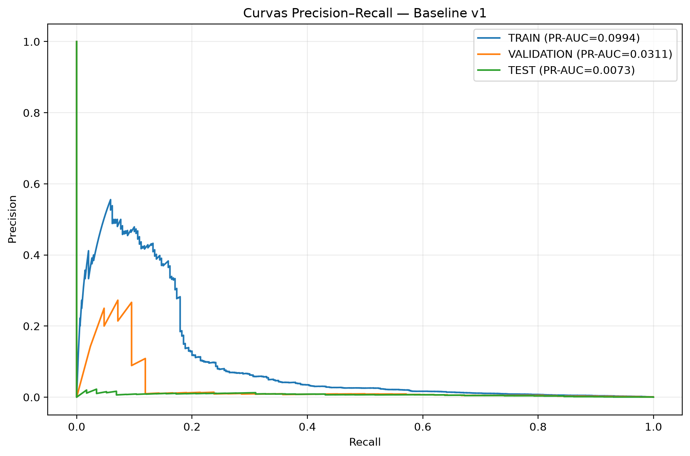
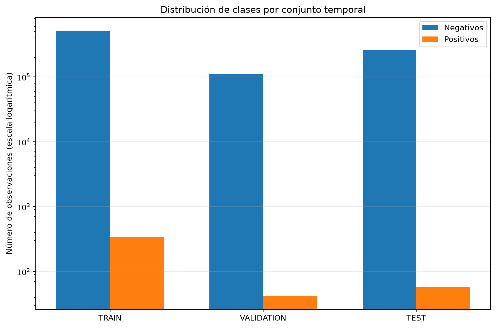
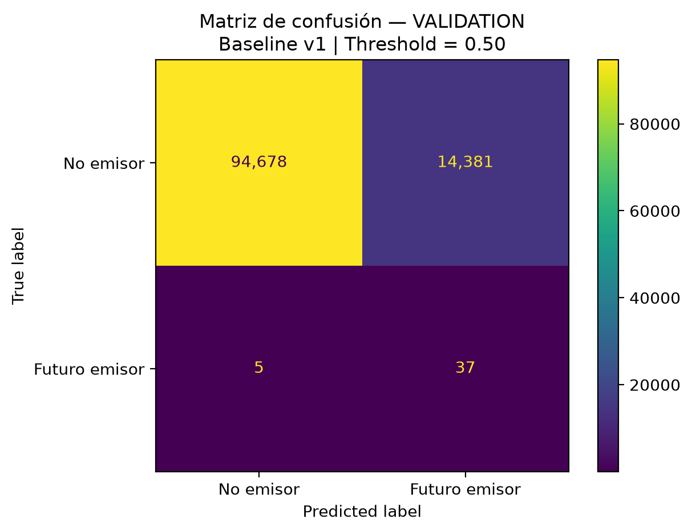
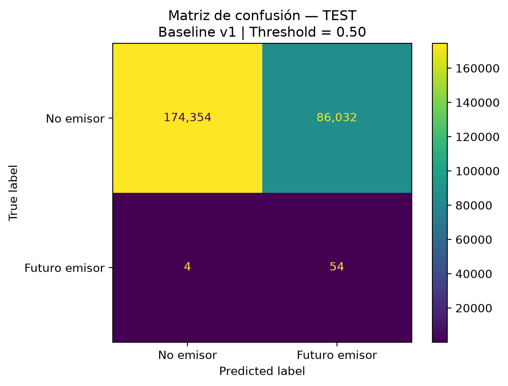
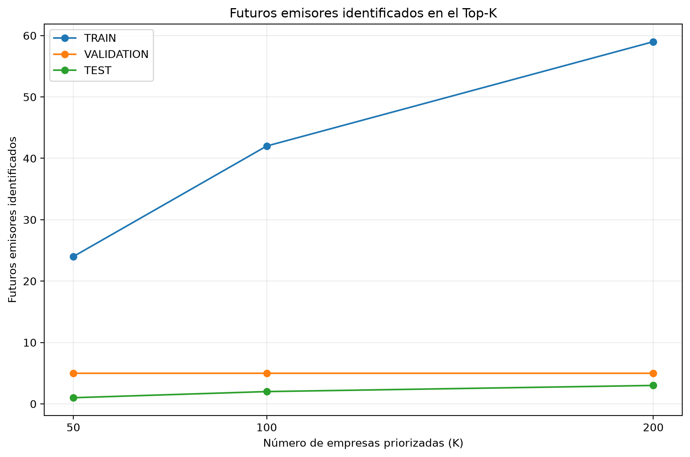
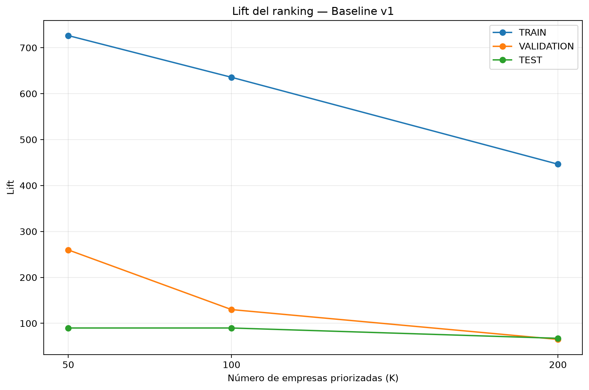
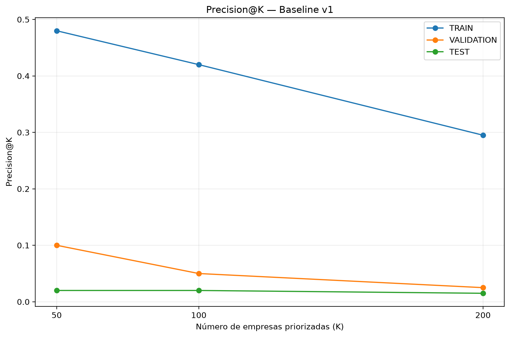

# Informe de resultados preliminares — Prospect Finder BVQ

## UNIVERSIDAD DE LAS AMÉRICAS

### Maestría en Inteligencia Artificial

**Proyecto:** Sistema inteligente basado en aprendizaje automático y redes neuronales para identificar y priorizar empresas con potencial de convertirse en emisores del mercado de valores ecuatoriano para la Bolsa de Valores Quito

**Integrantes:**

- Marcelo David Aguilar Salguero
- Francisco Xavier Meneses Játiva
- Luis Miguel Gallardo Dávila

**Fecha:** Septiembre de 2026

---

# 1. Descripción del prototipo desarrollado

El proyecto Prospect Finder BVQ busca desarrollar un sistema inteligente que permita identificar y priorizar empresas ecuatorianas con potencial de convertirse en futuros emisores del mercado de valores.

La necesidad parte de un problema organizacional de la Bolsa de Valores Quito (BVQ): existe un universo amplio de empresas que potencialmente podrían acceder al mercado de valores, pero analizarlo manualmente de forma sistemática resulta complejo. Esto dificulta aplicar criterios homogéneos de prospección, identificar señales relevantes y priorizar de manera consistente las empresas que podrían justificar un acercamiento comercial y un análisis especializado.

Como primera aproximación desarrollamos un modelo de referencia o baseline basado en regresión logística. Su propósito no es reemplazar el criterio comercial, financiero o legal de la BVQ, sino comprobar si existe señal predictiva en la información financiera histórica de las empresas y establecer un punto de comparación reproducible para modelos posteriores de mayor complejidad.

La unidad de análisis es `empresa-año`.

La variable objetivo es `TARGET_24M`, donde:

- `1`: la empresa se registra por primera vez como emisor dentro de los siguientes 24 meses;
- `0`: la empresa no se registra como nuevo emisor dentro de ese horizonte.

Las empresas que ya habían sido emisoras antes de la fecha de corte correspondiente fueron excluidas del universo elegible.

---

# 2. Fuentes de datos

## 2.1 Fuentes utilizadas

| Fuente | Formato principal | Información utilizada | Uso dentro del proyecto |
|---|---|---|---|
| Superintendencia de Compañías, Valores y Seguros — Estados financieros | ZIP / TXT | Estados financieros históricos, cuentas contables, identificación empresarial y CIIU | Construcción de variables predictoras |
| Superintendencia de Compañías, Valores y Seguros — Registro del Mercado de Valores | XLSX | Primera fecha de inscripción como emisor | Construcción de `TARGET_24M` |
| Bolsa de Valores Quito — Data Warehouse | CSV / base de datos | Información financiera complementaria | Validación y potencial enriquecimiento futuro |

La fuente principal utilizada para construir las variables predictoras corresponde a información financiera de la Superintendencia de Compañías, Valores y Seguros (SCVS).

Para construir la variable objetivo se utilizó información histórica del Registro del Mercado de Valores de la misma institución.

La información interna de la BVQ se considera una fuente complementaria de validación y enriquecimiento, pero no constituye la fuente principal de las variables utilizadas por el Baseline v1.

## 2.2 Archivos principales del Registro del Mercado de Valores

Los principales archivos utilizados para construir y validar la fecha de primera inscripción fueron:

- `listado_entes_65001_1789908466941.xlsx`
- `codigos_fichas_registrales_1789908530079.xlsx`

Se identificaron 619 RUC de emisores con información disponible en ambas fuentes.

La primera fecha de inscripción coincidió en los 619 casos contrastados.

Por esta razón, para el MVP se utiliza como evento la primera fecha de inscripción registrada en el listado de entes, validada contra las fichas registrales.

## 2.3 Período utilizado

El dataset etiquetado del MVP utiliza información financiera correspondiente al período:

**2015–2023**

Aunque existen archivos financieros de años posteriores, el horizonte de predicción de 24 meses limita actualmente la incorporación de años recientes en un dataset completamente etiquetado.

## 2.4 Condiciones de uso y fecha de extracción

Las fechas exactas de descarga o extracción y las condiciones de uso aplicables a cada fuente deben mantenerse documentadas de forma verificable.

En esta entrega no se asumen fechas ni licencias que no hayan sido confirmadas explícitamente.

La revisión y registro formal de estas condiciones forma parte de la documentación pendiente de fortalecimiento del proyecto.

---

# 3. Preparación y homologación de la información financiera

Durante la etapa de preparación se identificaron diferentes estructuras de planes contables, por lo que fue necesario construir un proceso de homologación.

Se analizaron ocho estructuras:

- `PLAN_413`
- `PLAN_622`
- `PLAN_639`
- `PLAN_807`
- `PLAN_819`
- `PLAN_830`
- `PLAN_868`
- `PLAN_925`

Para el MVP se utilizaron:

- `PLAN_622`
- `PLAN_639`
- `PLAN_807`
- `PLAN_819`
- `PLAN_830`
- `PLAN_868`
- `PLAN_925`

`PLAN_413` fue excluido del MVP debido a su baja cobertura, aproximadamente 730 observaciones, ausencia de eventos positivos en las cohortes evaluadas y dificultad para establecer una homologación comparable con las estructuras principales.

La homologación se controla mediante:

`config/scvs_account_mapping.csv`

Este archivo separa las reglas de equivalencia contable de la lógica del código, lo que facilita su revisión y mantenimiento.

---

# 4. Variables financieras homologadas

Se seleccionaron nueve variables financieras base:

| Variable | Tipo | Descripción |
|---|---|---|
| `ACTIVO_TOTAL` | Numérica | Total de activos |
| `ACTIVO_CORRIENTE` | Numérica | Total de activos corrientes |
| `EFECTIVO` | Numérica | Efectivo y equivalentes |
| `PASIVO_TOTAL` | Numérica | Total de pasivos |
| `PASIVO_CORRIENTE` | Numérica | Total de pasivos corrientes |
| `PASIVO_NO_CORRIENTE` | Numérica | Total de pasivos no corrientes |
| `PATRIMONIO` | Numérica | Patrimonio |
| `CAPITAL` | Numérica | Capital registrado |
| `UTILIDAD_NETA` | Numérica | Resultado neto del período |

Como resultado del proceso de homologación se obtuvo inicialmente:

- **887.469 observaciones empresa-año**
- **166.389 empresas únicas**
- período **2015–2023**

Archivo intermedio:

`data/interim/scvs_financials_harmonized_2015_2023.csv.gz`

---

# 5. Validación contable

La homologación fue evaluada mediante ecuaciones contables básicas.

## 5.1 Activo = Pasivo + Patrimonio

El **99,24 %** de las observaciones presentó una diferencia relativa menor o igual al **0,01 %**.

## 5.2 Pasivo total = Pasivo corriente + Pasivo no corriente

El **99,31 %** de las observaciones cumplió una diferencia relativa menor o igual al **0,01 %**.

Estas validaciones no garantizan por sí solas que cada cuenta se encuentre perfectamente homologada, pero constituyen una evidencia importante de consistencia estructural del dataset generado.

---

# 6. Construcción del dataset etiquetado

Para cada observación empresa-año se determina si la empresa todavía era elegible como prospecto en la fecha de corte.

La convención temporal actual utiliza como fecha de corte:

**31 de diciembre del año `t`**

Una observación recibe:

`TARGET_24M = 1`

cuando:

- la empresa todavía no era emisora al cierre del año `t`; y
- su primera inscripción como emisor ocurre posteriormente y hasta el 31 de diciembre del año `t + 2`.

Las empresas que ya eran emisoras quedan excluidas de observaciones posteriores.

El dataset resultante contiene:

| Indicador | Resultado |
|---|---:|
| Observaciones empresa-año | 884.072 |
| Empresas únicas | 166.107 |
| Casos positivos | 440 |
| Casos negativos | 883.632 |
| Prevalencia aproximada | 0,0498 % |

Archivo:

`data/processed/mvp_labeled_2015_2023.csv.gz`

El resultado evidencia un problema de clasificación extremadamente desbalanceado.

---

# 7. Distribución temporal de positivos

| Año | Positivos |
|---|---:|
| 2015 | 39 |
| 2016 | 58 |
| 2017 | 93 |
| 2018 | 78 |
| 2019 | 39 |
| 2020 | 33 |
| 2021 | 42 |
| 2022 | 36 |
| 2023 | 22 |
| **Total** | **440** |

La cantidad de nuevos emisores cambia de forma importante entre períodos.

Esta variación debe considerarse al interpretar la estabilidad temporal del modelo.

---

# 8. Ingeniería de variables

## 8.1 Transformaciones logarítmicas

Para reducir diferencias de escala se utiliza la transformación:

`sign(x) × log(1 + |x|)`

Se generan:

- `LOG_ACTIVO_TOTAL`
- `LOG_ACTIVO_CORRIENTE`
- `LOG_EFECTIVO`
- `LOG_PASIVO_TOTAL`
- `LOG_PASIVO_CORRIENTE`
- `LOG_PASIVO_NO_CORRIENTE`
- `LOG_PATRIMONIO`
- `LOG_CAPITAL`
- `LOG_UTILIDAD_NETA`

La transformación conserva el signo de valores negativos y permite reducir la influencia de diferencias extremas de magnitud.

## 8.2 Razones financieras

Se construyeron:

| Variable | Fórmula conceptual |
|---|---|
| `LIQUIDEZ_CORRIENTE` | Activo corriente / pasivo corriente |
| `ENDEUDAMIENTO` | Pasivo total / activo total |
| `AUTONOMIA_FINANCIERA` | Patrimonio / activo total |
| `ROA` | Utilidad neta / activo total |
| `EFECTIVO_ACTIVOS` | Efectivo / activo total |
| `CAPITAL_ACTIVOS` | Capital / activo total |
| `PASIVO_CORRIENTE_PASIVO` | Pasivo corriente / pasivo total |

Cuando un denominador no permite calcular una razón válida, el resultado se mantiene como faltante y se trata posteriormente dentro del pipeline de modelado.

## 8.3 Variable sectorial

Se incorpora:

`SECTOR_CIIU`

correspondiente a la primera sección de la clasificación CIIU de la empresa.

## 8.4 Variable de trazabilidad excluida del modelo

`PLAN_CONTABLE` se conserva únicamente para trazabilidad y control de calidad.

No se incorpora como predictor para reducir el riesgo de que el modelo aprenda cambios administrativos o históricos en las estructuras contables.

---

# 9. Disponibilidad de variables

Las variables financieras base homologadas presentan cobertura completa en el dataset armonizado utilizado para el MVP.

Las razones financieras presentan las siguientes disponibilidades aproximadas:

| Variable | Disponibilidad |
|---|---:|
| `LIQUIDEZ_CORRIENTE` | 68,04 % |
| `ENDEUDAMIENTO` | 95,81 % |
| `AUTONOMIA_FINANCIERA` | 95,81 % |
| `ROA` | 95,81 % |
| `EFECTIVO_ACTIVOS` | 95,81 % |
| `CAPITAL_ACTIVOS` | 95,81 % |
| `PASIVO_CORRIENTE_PASIVO` | 71,03 % |
| `SECTOR_CIIU` | 99,98 % |

Los faltantes numéricos se imputan dentro del pipeline utilizando únicamente estadísticas de TRAIN.

El detalle de cada variable, tipo, fórmula, disponibilidad y tratamiento de faltantes se mantiene en:

`docs/diccionario_datos.md`

---

# 10. División temporal de los datos

No se utiliza una división aleatoria.

La partición se realiza cronológicamente:

| Conjunto | Período | Observaciones | Positivos | Prevalencia |
|---|---|---:|---:|---:|
| TRAIN | 2015–2020 | 514.527 | 340 | 0,0661 % |
| VALIDATION | 2021 | 109.101 | 42 | 0,0385 % |
| TEST | 2022–2023 | 260.444 | 58 | 0,0223 % |

El objetivo es aproximar un escenario en el que el modelo aprende con información histórica y posteriormente se aplica a períodos futuros.

El preprocesamiento, imputación, escalamiento y codificación se ajustan exclusivamente utilizando TRAIN.

---

# 11. Consideración crítica sobre disponibilidad temporal

Aunque la división es temporal, existe una limitación que debe mantenerse explícita.

La observación se organiza por año fiscal, pero un estado financiero correspondiente al año `t` puede haber sido presentado o publicado durante el año `t + 1`.

Por tanto, la fecha contable no necesariamente coincide con la fecha exacta en que la información estuvo disponible para una predicción real.

Antes de una implementación operativa deberá verificarse:

- fecha de presentación;
- fecha de publicación;
- fecha efectiva de disponibilidad;
- relación de estas fechas con el evento de primera inscripción.

Esta revisión es prioritaria porque una característica utilizada antes de haber estado realmente disponible produciría leakage temporal.

---

# 12. Modelo de referencia

Como modelo inicial se utiliza una regresión logística regularizada.

Configuración del Baseline v1:

| Parámetro | Valor |
|---|---|
| Modelo | Logistic Regression |
| Regularización | L2 |
| `C` | 1,0 |
| `class_weight` | balanced |
| `solver` | lbfgs |
| `max_iter` | 2000 |
| `random_state` | 42 |

El modelo convergió en 92 iteraciones.

Script:

`src/models/train_logistic_baseline.py`

Este modelo constituye el punto de referencia frente al cual se comparan las siguientes iteraciones.

---

# 13. Preprocesamiento

## 13.1 Variables numéricas

Se utiliza:

- `SimpleImputer(strategy="median")`
- `StandardScaler()`

## 13.2 Variable categórica

Para `SECTOR_CIIU` se utiliza:

- `SimpleImputer(strategy="most_frequent")`
- `OneHotEncoder(handle_unknown="ignore")`

Todos los parámetros del preprocesamiento se calculan con TRAIN y posteriormente se aplican a VALIDATION y TEST.

---

# 14. Tratamiento del desbalance

La prevalencia positiva global es aproximadamente:

**0,0498 %**

El Baseline v1 utiliza:

`class_weight="balanced"`

para evitar que la regresión logística favorezca casi exclusivamente a la clase negativa.

Esta decisión mejora la capacidad del modelo para detectar positivos, pero también implica que los valores generados por `predict_proba()` no deben interpretarse todavía como probabilidades reales calibradas.

Por esta razón, un score de 0,90 no debe interpretarse como una probabilidad real del 90 % de convertirse en emisor.

---

# 15. Métricas seleccionadas

Debido al desbalance extremo, `Accuracy` no se utiliza como criterio principal.

Las métricas generales son:

- PR-AUC;
- ROC-AUC;
- Precision;
- Recall;
- F1.

Para relacionar el modelo con la necesidad de priorización comercial se utilizan adicionalmente:

- Precision@K;
- Recall@K;
- Lift@K.

Inicialmente se evalúan:

- K = 50;
- K = 100;
- K = 200.

---

# 16. Resultados preliminares del Baseline v1

## 16.1 Métricas generales

| Conjunto | PR-AUC | ROC-AUC | Precision | Recall | F1 |
|---|---:|---:|---:|---:|---:|
| TRAIN | 0,099413 | 0,946436 | 0,004494 | 0,894118 | 0,008942 |
| VALIDATION | 0,031095 | 0,940593 | 0,002566 | 0,880952 | 0,005118 |
| TEST | 0,007291 | 0,927740 | 0,000627 | 0,931034 | 0,001254 |

El ROC-AUC permanece por encima de 0,92 en los tres conjuntos.

Sin embargo, debido al desbalance extremo, PR-AUC y las métricas de ranking son más representativas para evaluar la utilidad del modelo.

Se observa una reducción del PR-AUC:

- TRAIN: 0,099413
- VALIDATION: 0,031095
- TEST: 0,007291

Este comportamiento evidencia una degradación temporal que debe continuar investigándose.

**Figura 1.** Curva Precision-Recall del Baseline v1. Fuente: elaboración propia.

---

# 17. Desbalance de clases

La cantidad limitada de nuevos emisores constituye uno de los principales retos del problema.

El modelo debe identificar patrones útiles a partir de aproximadamente 0,05 % de observaciones positivas.

**Figura 2.** Distribución de clases por conjunto temporal. Fuente: elaboración propia.

---

# 18. Análisis del umbral de clasificación

Inicialmente se utiliza un umbral diagnóstico de:

`0,50`

## 18.1 VALIDATION

| Resultado | Cantidad |
|---|---:|
| Verdaderos positivos | 37 |
| Falsos negativos | 5 |
| Falsos positivos | 14.381 |
| Verdaderos negativos | 94.678 |

**Figura 3.** Matriz de confusión en VALIDATION. Fuente: elaboración propia.

El modelo identifica 37 de los 42 futuros emisores, pero genera 14.381 falsos positivos.

## 18.2 TEST

| Resultado | Cantidad |
|---|---:|
| Verdaderos positivos | 54 |
| Falsos negativos | 4 |
| Falsos positivos | 86.032 |
| Verdaderos negativos | 174.354 |

**Figura 4.** Matriz de confusión en TEST. Fuente: elaboración propia.

Los resultados muestran que el umbral de 0,50 no es adecuado como regla operativa de prospección.

Por esta razón, el problema se interpreta principalmente como un problema de **ranking y priorización**, más que como una clasificación binaria convencional.

---

# 19. Resultados de ranking

## 19.1 TRAIN

| K | Futuros emisores | Precision@K | Recall@K | Lift@K |
|---:|---:|---:|---:|---:|
| 50 | 24 | 0,4800 | 0,0706 | 726,39 |
| 100 | 42 | 0,4200 | 0,1235 | 635,59 |
| 200 | 59 | 0,2950 | 0,1735 | 446,43 |

## 19.2 VALIDATION

| K | Futuros emisores | Precision@K | Recall@K | Lift@K |
|---:|---:|---:|---:|---:|
| 50 | 5 | 0,1000 | 0,1190 | 259,76 |
| 100 | 5 | 0,0500 | 0,1190 | 129,88 |
| 200 | 5 | 0,0250 | 0,1190 | 64,94 |

## 19.3 TEST

| K | Futuros emisores | Precision@K | Recall@K | Lift@K |
|---:|---:|---:|---:|---:|
| 50 | 1 | 0,0200 | 0,0172 | 89,81 |
| 100 | 2 | 0,0200 | 0,0345 | 89,81 |
| 200 | 3 | 0,0150 | 0,0517 | 67,36 |

**Figura 5.** Futuros emisores identificados en el Top-K. Fuente: elaboración propia.

**Figura 6.** Lift del ranking por conjunto temporal. Fuente: elaboración propia.

**Figura 7.** Precision@K por conjunto temporal. Fuente: elaboración propia.

---

# 20. Interpretación del ranking

Los resultados muestran que el modelo concentra futuros emisores en las primeras posiciones con una frecuencia considerablemente superior a una selección aleatoria.

En VALIDATION, dentro de las primeras 50 empresas priorizadas aparecen 5 futuros emisores:

- Precision@50 = 10 %
- Recall@50 = 11,90 %
- Lift@50 = 259,76

El Lift@50 indica que la concentración de futuros emisores dentro de las primeras posiciones es aproximadamente 260 veces superior a la prevalencia promedio del conjunto de VALIDATION.

Sin embargo, la capacidad de concentración disminuye en TEST:

- Top 50 identifica 1 futuro emisor;
- Top 100 identifica 2;
- Top 200 identifica 3.

Aunque el Lift continúa siendo superior al de una selección aleatoria, la cobertura todavía es insuficiente para considerar el modelo como una herramienta operativa definitiva.

---

# 21. Posición de los futuros emisores

## 21.1 VALIDATION

| Ranking | Positivos encontrados | Recall |
|---|---:|---:|
| Top 50 | 5 | 11,90 % |
| Top 100 | 5 | 11,90 % |
| Top 200 | 5 | 11,90 % |
| Top 500 | 5 | 11,90 % |
| Top 1.000 | 10 | 23,81 % |

Resultados adicionales:

- mejor posición positiva: 7;
- mediana de posición positiva: 2.362,5;
- peor posición positiva: 64.033.

## 21.2 TEST

| Ranking | Positivos encontrados | Recall |
|---|---:|---:|
| Top 50 | 1 | 1,72 % |
| Top 100 | 2 | 3,45 % |
| Top 200 | 3 | 5,17 % |
| Top 500 | 4 | 6,90 % |
| Top 1.000 | 10 | 17,24 % |

Resultados adicionales:

- mejor posición positiva: 50;
- mediana de posición positiva: 4.317;
- peor posición positiva: 160.698.

Estos resultados refuerzan la evidencia de una disminución temporal en la capacidad del modelo para concentrar futuros emisores en las primeras posiciones.

---

# 22. Análisis de errores

Se analizaron de forma agregada:

- verdaderos positivos;
- falsos positivos;
- falsos negativos;
- verdaderos negativos;
- posición de positivos en el ranking;
- sectores asociados a errores;
- perfiles financieros de los errores.

En VALIDATION se identificaron cinco falsos negativos.

Los sectores observados fueron:

- F
- M
- H
- N
- R

En TEST se identificaron cuatro falsos negativos y los cuatro correspondieron al sector A.

Estos resultados se interpretan únicamente como comportamientos observados.

El número de falsos negativos es demasiado reducido para concluir que exista un problema general con un sector específico.

---

# 23. Perfil financiero de falsos negativos

## 23.1 VALIDATION

| Variable | Mediana TP | Mediana FN |
|---|---:|---:|
| `LOG_ACTIVO_TOTAL` | 16,1125 | 14,7207 |
| `LIQUIDEZ_CORRIENTE` | 1,1588 | 2,0661 |
| `ENDEUDAMIENTO` | 0,7749 | 0,6579 |
| `AUTONOMIA_FINANCIERA` | 0,2251 | 0,3421 |
| `PASIVO_CORRIENTE_PASIVO` | 0,7657 | 0,5787 |

En VALIDATION, los falsos negativos presentan, en términos medianos:

- menor tamaño;
- mayor liquidez;
- menor endeudamiento;
- mayor autonomía financiera.

Estos resultados son descriptivos y no implican causalidad.

## 23.2 TEST

Los cuatro falsos negativos de TEST presentan un perfil especialmente diferente al patrón predominante:

- `LOG_ACTIVO_TOTAL` mediano aproximado: 6,6859;
- pasivo total igual a cero;
- patrimonio y capital cercanos al nivel del activo;
- endeudamiento igual a cero;
- autonomía financiera cercana a 1;
- elevada proporción de efectivo respecto a activos;
- razones asociadas al pasivo con valores faltantes cuando el denominador es cero.

Debido a que se trata de solo cuatro observaciones, este comportamiento debe tratarse como una señal exploratoria y no como una conclusión general.

---

# 24. Análisis de la variable sectorial

En el Baseline v1 varios coeficientes de mayor magnitud corresponden a `SECTOR_CIIU`.

La distribución de positivos en TRAIN muestra una concentración importante:

| Sector | Positivos en TRAIN |
|---|---:|
| G | 128 |
| C | 102 |
| A | 24 |
| F | 14 |
| N | 12 |
| E | 12 |
| K | 11 |

Los sectores G y C concentran:

**230 de 340 positivos de TRAIN, aproximadamente 67,6 %.**

También existen sectores con muy pocos o ningún evento positivo.

Esto puede producir coeficientes sectoriales inestables.

---

# 25. Experimento v2 — Eliminación de SECTOR_CIIU

Para evaluar si la variable sectorial estaba introduciendo inestabilidad se construyó una segunda regresión logística eliminando completamente `SECTOR_CIIU`.

Se mantuvieron:

- el mismo dataset;
- el mismo split temporal;
- el mismo algoritmo;
- `C = 1`;
- `class_weight = balanced`;
- regularización L2.

El conjunto TEST no fue utilizado durante la selección de esta alternativa.

## 25.1 Resultados en VALIDATION

| Métrica | Baseline v1 | Baseline v2 |
|---|---:|---:|
| PR-AUC | 0,031095 | 0,024402 |
| ROC-AUC | 0,940593 | 0,961619 |
| Precision | 0,002566 | 0,002485 |
| Recall | 0,880952 | 0,952381 |
| F1 | 0,005118 | 0,004956 |
| Precision@50 | 0,1000 | 0,0800 |
| Recall@50 | 0,1190 | 0,0952 |
| Lift@50 | 259,76 | 207,81 |

Aunque ROC-AUC y Recall al threshold de 0,50 aumentan, las métricas consideradas prioritarias para el problema de ranking disminuyen.

El PR-AUC se reduce aproximadamente un 21,5 %.

Top 100 y Top 200 no presentan una mejora respecto del Baseline v1.

## 25.2 Decisión

Se mantiene `SECTOR_CIIU` dentro del modelo de referencia.

La mejora de ROC-AUC no se considera suficiente para sustituir el Baseline v1 porque no mejora las métricas relacionadas directamente con la priorización.

---

# 26. Experimento v3 — Regularización

Se evaluó el efecto de modificar el parámetro `C` manteniendo `SECTOR_CIIU`.

Valores evaluados:

- 0,001
- 0,01
- 0,1
- 1
- 10

El conjunto TEST no fue utilizado durante este experimento.

## 26.1 Resultados en VALIDATION

| C | PR-AUC | ROC-AUC | Positivos Top 50 |
|---:|---:|---:|---:|
| 0,001 | 0,024217 | 0,955848 | 4 |
| 0,01 | 0,027559 | 0,951061 | 4 |
| 0,1 | 0,030555 | 0,946416 | 5 |
| 1 | 0,031095 | 0,940593 | 5 |
| 10 | 0,031135 | 0,934021 | 5 |

`C = 10` obtiene el PR-AUC numéricamente más alto.

La diferencia frente a `C = 1` es:

**0,000040**

equivalente aproximadamente a un **0,13 % relativo**.

Los resultados Top 50, Top 100 y Top 200 son iguales para `C = 1` y `C = 10`.

Además, ROC-AUC disminuye con `C = 10`.

## 26.2 Decisión

No se considera que exista una mejora material suficiente para modificar el modelo de referencia.

Se mantiene:

`C = 1.0`

---

# 27. Uso del conjunto TEST

El conjunto:

**TEST 2022–2023**

fue utilizado para la evaluación final del Baseline v1 después de establecer su configuración.

Los análisis gráficos y de errores posteriores reproducen los resultados del mismo modelo ya fijado y no fueron utilizados para modificar retrospectivamente sus parámetros.

Los experimentos:

- Baseline v2;
- experimento v3 de regularización;

fueron comparados utilizando únicamente:

- TRAIN;
- VALIDATION.

TEST no fue utilizado para seleccionar esas alternativas.

Esta distinción es importante para mantener trazabilidad sobre qué información participó en la selección de cada versión.

---

# 28. Modelo de referencia actual

Se mantiene como referencia:

- modelo: Regresión logística;
- `C = 1.0`;
- `class_weight = balanced`;
- regularización L2;
- `SECTOR_CIIU` incluido.

Los experimentos v2 y v3 muestran que:

- eliminar completamente la información sectorial no mejora las métricas prioritarias;
- modificar únicamente la intensidad de regularización tampoco produce una mejora material.

Por tanto, el Baseline v1 continúa siendo la referencia para evaluar las siguientes iteraciones.

---

# 29. Fortalezas encontradas

## 29.1 Existe señal predictiva

Las variables financieras permiten diferenciar parcialmente empresas que posteriormente se convierten en emisores.

## 29.2 El ranking supera una selección aleatoria

Los valores de Lift muestran una concentración de futuros emisores muy superior a la prevalencia general, especialmente en TRAIN y VALIDATION.

## 29.3 La evaluación respeta el orden temporal

No se utiliza una división aleatoria.

La separación cronológica aproxima mejor el escenario de aplicación futura del modelo.

## 29.4 El preprocesamiento se ajusta únicamente con TRAIN

La imputación, escalamiento y codificación se calculan con TRAIN y posteriormente se aplican a los demás conjuntos.

## 29.5 Existe trazabilidad técnica

El proyecto dispone de:

- scripts separados por etapa;
- resultados versionados;
- documentación por experimento;
- README;
- bitácora;
- backlog;
- diccionario de datos;
- inventario de fuentes;
- entorno técnico documentado.

---

# 30. Limitaciones encontradas

## 30.1 Desbalance extremo

Existen solamente 440 positivos frente a 883.632 negativos.

TRAIN contiene 340 casos positivos.

VALIDATION contiene 42.

TEST contiene 58.

Esto limita la capacidad del modelo para aprender una variedad amplia de perfiles de futuros emisores.

## 30.2 Degradación temporal

El desempeño disminuye al avanzar hacia períodos posteriores.

Entre las hipótesis de trabajo se encuentran:

- cambios en la composición de las empresas;
- cambios en prevalencia;
- cambios sectoriales;
- condiciones económicas distintas;
- variables todavía no incorporadas;
- relaciones no lineales;
- reducido número de eventos positivos.

Estas posibilidades son hipótesis de trabajo y no conclusiones demostradas.

## 30.3 Variables principalmente estáticas

El modelo utiliza principalmente una fotografía financiera anual.

Todavía no incorpora:

- crecimiento interanual;
- tendencia de activos;
- tendencia de patrimonio;
- evolución del endeudamiento;
- evolución de liquidez;
- estabilidad de utilidades;
- crecimiento acumulado;
- volatilidad financiera.

## 30.4 Modelo lineal

La regresión logística modela relaciones lineales en el espacio transformado.

Pueden existir interacciones no lineales entre:

- tamaño;
- liquidez;
- endeudamiento;
- rentabilidad;
- sector;
- crecimiento.

## 30.5 Scores no calibrados

Debido a `class_weight="balanced"`, los scores actuales no deben interpretarse como probabilidades reales.

Por esta razón todavía no se utilizan directamente como Índice de Afinidad Bursátil.

## 30.6 Disponibilidad temporal de información

La fecha de cierre del estado financiero no garantiza que la información hubiera estado disponible públicamente en esa misma fecha.

Este aspecto requiere una revisión específica antes de considerar una implementación operativa.

---

# 31. Relación con la necesidad organizacional de la BVQ

Los resultados preliminares muestran que la inteligencia artificial puede aportar una metodología para reducir y ordenar un universo amplio de empresas.

El uso esperado del sistema sería apoyar a la BVQ para:

- analizar un universo amplio de compañías;
- aplicar criterios homogéneos;
- generar un ranking;
- enfocar recursos comerciales;
- complementar el ranking con criterios financieros y comerciales;
- facilitar el análisis posterior por especialistas.

El sistema no pretende determinar automáticamente qué empresa debe convertirse en emisor.

Su función sería apoyar la priorización y reducir el universo inicial de análisis.

---

# 32. Backlog priorizado

El backlog detallado se mantiene en:

`docs/backlog.md`

La siguiente tabla resume las actividades actuales.

| ID | Prioridad | Actividad | Estado |
|---|---|---|---|
| B07 | Alta | Fortalecer control temporal de disponibilidad de datos | Pendiente |
| B01 | Alta | Construir variables temporales | Pendiente |
| B02 | Alta | Construir tasas de crecimiento | Pendiente |
| B03 | Alta | Construir tendencias multianuales | Pendiente |
| B04 | Alta | Evaluar Gradient Boosting | Pendiente |
| B05 | Alta | Evaluar CatBoost | Pendiente |
| B06 | Alta | Comparar nuevos modelos contra Baseline v1 | Pendiente |
| B09 | Media | Evaluar estrategias de desbalance | Pendiente |
| B10 | Media | Ampliar análisis de Top-K | Pendiente |
| B11 | Media | Analizar estabilidad temporal por cohortes | Pendiente |
| B08 | Media | Evaluar Random Forest | Pendiente |
| B12 | Media | Evaluar nuevas fuentes | Pendiente |
| B13 | Media | Evaluar calibración | Pendiente |
| B15 | Media | Incorporar interpretabilidad | Pendiente |
| B14 | Media | Construir Índice de Afinidad Bursátil | Pendiente |
| B17 | Baja | Evaluar MLP | Pendiente |
| B18 | Baja | Diseñar prototipo de visualización | Pendiente |
| B19 | Baja | Evaluar monitoreo de drift | Pendiente |

El diccionario de datos, que anteriormente se consideraba una necesidad de documentación, ya se encuentra formalizado en:

`docs/diccionario_datos.md`

---

# 33. Próximas mejoras técnicas

## 33.1 Variables temporales

Se priorizará la construcción de:

- crecimiento anual de activos;
- crecimiento de patrimonio;
- variación de capital;
- variación de endeudamiento;
- variación de liquidez;
- crecimiento de utilidad;
- estabilidad de resultados;
- tendencia de dos y tres años;
- crecimiento acumulado.

El objetivo es pasar de una fotografía financiera a una representación de la trayectoria empresarial.

## 33.2 Modelos no lineales

Se evaluarán:

- Gradient Boosting;
- CatBoost;
- Random Forest.

Estos modelos permitirán analizar si existen relaciones no lineales e interacciones que la regresión logística no representa adecuadamente.

## 33.3 Redes neuronales

Posteriormente se evaluará una red neuronal multicapa o MLP.

Debido al reducido número de positivos será necesario controlar:

- sobreajuste;
- regularización;
- arquitectura;
- ponderación de clases;
- estabilidad temporal.

## 33.4 Tratamiento del desbalance

Se evaluarán alternativas como:

- diferentes pesos de clase;
- undersampling controlado;
- estrategias compatibles con validación temporal.

Cualquier técnica de remuestreo deberá aplicarse exclusivamente sobre TRAIN.

## 33.5 Optimización del ranking

Se ampliará la evaluación hacia:

- Top 25;
- Top 50;
- Top 100;
- Top 200;
- Top 500;
- Top 1.000.

El objetivo es relacionar K con la capacidad real de gestión comercial de la BVQ.

## 33.6 Nuevas fuentes

Después de explotar las variables históricas disponibles se podrá evaluar información adicional proveniente de:

- SCVS;
- información interna de BVQ;
- fuentes públicas empresariales;
- variables sectoriales;
- variables macroeconómicas.

Toda fuente adicional deberá cumplir una regla obligatoria:

**la información utilizada como predictor debe haber estado disponible antes de la fecha de predicción.**

## 33.7 Calibración

Después de seleccionar una familia de modelo con desempeño adecuado se evaluará calibración.

El objetivo será obtener scores con una interpretación probabilística más consistente.

## 33.8 Interpretabilidad

Se evaluarán mecanismos como:

- coeficientes en modelos lineales;
- importancia de variables;
- SHAP en modelos compatibles;
- explicaciones locales y globales.

---

# 34. Índice de Afinidad Bursátil

El proyecto contempla posteriormente la construcción de un:

**Índice de Afinidad Bursátil (IAB)**

El IAB no debe definirse todavía como una simple transformación de los scores actuales porque estos no se encuentran calibrados.

Su construcción deberá realizarse después de:

1. seleccionar un modelo con desempeño suficiente;
2. evaluar estabilidad temporal;
3. calibrar los scores cuando corresponda;
4. definir una escala interpretable;
5. validar su utilidad con usuarios de negocio.

---

# 35. Herramientas y entorno tecnológico

| Herramienta | Versión / uso |
|---|---|
| Python | 3.13.7 |
| pandas | 3.0.5 |
| NumPy | 2.5.3 |
| scikit-learn | 1.9.1 |
| SciPy | 1.18.1 |
| Matplotlib | 3.11.1 |
| joblib | 1.6.0 |
| openpyxl | 3.1.5 |
| Jupyter | 1.1.1 |
| Git | Control de versiones |
| GitHub | Repositorio remoto privado |
| Visual Studio Code | Entorno de desarrollo |
| PowerShell | Ejecución y administración del entorno |

Las versiones completas del entorno se conservan en:

- `requirements.txt`
- `requirements-lock.txt`

La descripción detallada se encuentra en:

`docs/entorno_tecnico.md`

---

# 36. Evidencias de reproducibilidad

El proyecto se encuentra versionado mediante Git y GitHub.

## 36.1 Código principal

| Componente | Archivo |
|---|---|
| Construcción del dataset armonizado | `src/data/build_scvs_harmonized_dataset.py` |
| Validación del dataset armonizado | `src/data/validate_scvs_harmonized_dataset.py` |
| Construcción del dataset etiquetado | `src/data/build_mvp_labeled_dataset.py` |
| Ingeniería de variables | `src/features/build_mvp_features.py` |
| Baseline v1 | `src/models/train_logistic_baseline.py` |
| Análisis sectorial | `src/evaluation/analyze_sector_stability.py` |
| Baseline v2 | `src/models/train_logistic_no_sector_v2.py` |
| Experimento v3 | `src/models/tune_logistic_regularization_v3.py` |
| Figuras | `src/evaluation/generate_baseline_figures.py` |
| Análisis de errores | `src/evaluation/analyze_baseline_errors.py` |

## 36.2 Documentación

| Documento | Propósito |
|---|---|
| `README.md` | Punto de entrada y visión general |
| `docs/pipeline_datos_mvp.md` | Pipeline completo del MVP |
| `docs/inventario_fuentes.md` | Inventario de fuentes |
| `docs/diccionario_datos.md` | Variables, tipos, fórmulas y faltantes |
| `docs/entorno_tecnico.md` | Entorno y versiones |
| `docs/baseline_v1.md` | Documentación del modelo de referencia |
| `docs/baseline_v2.md` | Experimento sin sector |
| `docs/baseline_v3.md` | Experimento de regularización |
| `docs/bitacora.md` | Registro cronológico de decisiones y aprendizajes |
| `docs/backlog.md` | Actividades priorizadas |
| `docs/informe_resultados_preliminares.md` | Consolidación de resultados |

## 36.3 Resultados

Los resultados agregados se encuentran en:

`reports/results/`

Las figuras se encuentran en:

`reports/figures/`

Los datasets originales, intermedios y procesados no se almacenan en Git.

Los modelos binarios reconstruibles tampoco se versionan.

## 36.4 Control de versiones

Los principales hitos del proyecto se encuentran registrados mediante commits de Git.

La actualización de documentación y reproducibilidad fue consolidada en el commit:

`ed1034d — Complete project documentation and reproducibility records`

---

# 37. Uso responsable

El proyecto se desarrolla actualmente con fines académicos, experimentales y de investigación aplicada.

Los resultados del modelo:

- no constituyen recomendaciones de inversión;
- no determinan automáticamente la aceptación de una empresa como emisor;
- no sustituyen el análisis financiero, legal o comercial realizado por especialistas;
- no deben utilizarse como único criterio para tomar decisiones comerciales;
- no deben interpretarse como probabilidades reales mientras los scores no se encuentren calibrados.

El sistema se concibe como una herramienta de apoyo para priorizar empresas que posteriormente deben ser revisadas por personas con conocimiento del mercado.

Los resultados agregados versionados no incluyen nombres de empresas, RUC ni predicciones individuales.

Los datos originales y derivados no se publican en el repositorio.

---

# 38. Conclusiones preliminares

Los resultados obtenidos permiten establecer que existe una señal predictiva preliminar en la información financiera histórica para priorizar empresas que posteriormente se convierten en emisores del mercado de valores.

La regresión logística desarrollada como Baseline v1 alcanza valores de ROC-AUC superiores a 0,92 y genera rankings con niveles de Lift considerablemente superiores a una selección aleatoria.

Sin embargo, el problema presenta un desbalance extremo y una degradación importante del desempeño al avanzar hacia períodos posteriores.

El análisis del threshold de 0,50 muestra que una clasificación binaria convencional genera una cantidad demasiado elevada de falsos positivos. Por esta razón, la formulación más útil para el proyecto es la de un sistema de ranking y priorización.

Los experimentos realizados muestran que eliminar `SECTOR_CIIU` reduce el desempeño de las métricas prioritarias y que modificar únicamente la intensidad de regularización no produce una mejora material.

El análisis de errores también muestra que algunos futuros emisores presentan perfiles financieros diferentes del patrón predominante aprendido por el modelo, aunque el reducido número de estos casos impide obtener conclusiones generales.

El siguiente avance relevante deberá concentrarse en fortalecer el control temporal de disponibilidad de la información, incorporar variables de crecimiento y tendencia, y evaluar modelos capaces de capturar relaciones no lineales.

En esta etapa, el proyecto demuestra la viabilidad técnica del pipeline y evidencia la existencia de señal predictiva preliminar. No obstante, todavía no demuestra un desempeño suficiente para uso operativo autónomo.

La evolución del sistema se orientará a convertirse en una herramienta de apoyo para el análisis y la prospección comercial de la Bolsa de Valores Quito, manteniendo la decisión final bajo revisión humana.
